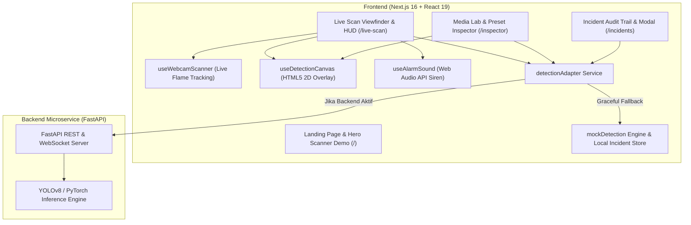

# 🔥 Fire & Smoke Detection System — AI Vision Command Center

Platform pemantauan dan deteksi dini anomali api (*fire*) serta kepulan asap (*smoke*) berbasis *Computer Vision* dengan antarmuka **Security Operations Command Center** modern, modular, dan responsif.

[](https://nextjs.org/)
[](https://react.dev/)
[](https://tailwindcss.com/)
[](https://fastapi.tiangolo.com/)
[](https://python.org/)
[](https://www.typescriptlang.org/)

---

## 📌 Ringkasan Proyek

Platform ini dirancang untuk mendeteksi bahaya kebakaran dan kepulan asap secara *real-time* melalui umpan kamera CCTV, pemindaian **Live Webcam** langsung dari browser, maupun analisis file media statis (gambar/video).

Dibangun dengan arsitektur **terpisah (*decoupled*)**:
- **Frontend (Next.js 16 + React 19):** Antarmuka *Dark Operations Command Center*, overlay *bounding box* berakselerasi perangkat keras via HTML5 2D Canvas, pemindai titik api webcam real-time (`useWebcamScanner`), serta sirine audio sintetis berbasis Web Audio API lokal. Dilengkapi *graceful client fallback* & *mock engine* sehingga aplikasi dapat langsung dijalankan penuh tanpa ketergantungan server backend.
- **Backend (FastAPI Microservice Template):** Menyediakan kontrak REST API & WebSocket berstandar OpenAPI yang siap diintegrasikan langsung dengan model *deep learning* **YOLOv8 / PyTorch**.

---

## ✨ Fitur Utama

| Modul | Fitur & Kapabilitas |
| :--- | :--- |
| 🌐 **Interactive Landing Page (`/`)** | • **Hero Scanner Demo**: Simulasi pemindaian interaktif langsung di halaman utama.<br>• **Bento Architecture & Dual-Detection Stage**: Visualisasi pipeline deteksi ganda (Api & Asap).<br>• **Benchmark & Workflow Sections**: Perbandingan performa latensi/akurasi serta elemen CTA interaktif (`SpecularButton`). |
| 🛡️ **Live Scan Command Center (`/live-scan`)** | • **Real-Time Webcam Fire Scanner**: Deteksi titik api langsung dari kamera laptop (`useWebcamScanner`) dengan pemilihan kamera fisik otomatis (bypass virtual camera/OBS).<br>• **Simulated CCTV Streams**: Mode simulasi skenario kebakaran, asap, dan kondisi aman.<br>• **HUD Overlay & Telemetry Sidebar**: Tampilan koordinat *bounding box* dinamis, metrik suhu/kepadatan asap, sirine audio Web Audio API, dan *auto-incident logging*. |
| 🔬 **Media Inspector (`/inspector`)** | • **Drag & Drop + One-Click Presets**: Unggah gambar/video sendiri atau uji cepat dengan sampel preset bawaan (*Fire*, *Smoke*, *Dual Detection*).<br>• **Interactive Threshold & Class Controls**: Slider *confidence threshold* (10% – 95%) dan filter kelas secara *real-time*.<br>• **Annotated Snapshot Export**: Unduh hasil tangkapan layar lengkap dengan gambar *bounding box* dan label akurasi. |
| 📋 **Incident Logs & Audit Trail (`/incidents`)** | • **Auto-Recorded Webcam & CCTV Incidents**: Menyimpan otomatis tangkapan layar (*snapshot*) saat api terdeteksi di Live Scan.<br>• **Stat Cards & Advanced Filters**: Ringkasan metrik insiden, filter berdasarkan tingkat keparahan, status, dan pencarian kata kunci.<br>• **Snapshot Inspection Modal & CSV Export**: Pratinjau detail koordinat deteksi per insiden dan unduh laporan audit dalam format CSV. |

---

## 🏗️ Arsitektur Sistem



---

## 📁 Struktur Direktori

```text
fire-smoke-detection/
├── docs/                                         # Dokumentasi desain & spesifikasi sistem
│   ├── stitch/                                   # Referensi desain layar UI
│   └── superpowers/                              # Spesifikasi arsitektur & rencana implementasi
├── frontend/                                     # Aplikasi Frontend Next.js (App Router)
│   ├── public/
│   │   ├── illustrations/                        # Aset visual bento grid & pipeline arsitektur
│   │   ├── presets/                              # Sampel gambar preset (fire, smoke, dual)
│   │   └── hero-fire-smoke.webp                  # Aset latar belakang hero teroptimasi (WebP)
│   ├── src/
│   │   ├── app/                                  # Routing halaman (/, /live-scan, /inspector, /incidents)
│   │   ├── components/
│   │   │   ├── common/                           # HeaderNav, Footer, SpecularButton
│   │   │   ├── home/                             # HeroSection, HeroScannerDemo, Architecture, Benchmark, Workflow
│   │   │   ├── live-scan/                        # ViewfinderStream, ViewfinderTopBar, DetectionHudOverlay, TelemetrySidebar
│   │   │   ├── inspector/                        # MediaUploader, InspectorPreviewCanvas, PlaybackControls, DetectionTable
│   │   │   ├── incidents/                        # IncidentStatCards, IncidentFilters, IncidentTable, SnapshotModal
│   │   │   └── command-center/                   # DetectionCanvas
│   │   ├── hooks/                                # useWebcamScanner, useDetectionCanvas, useAlarmSound
│   │   ├── services/                             # detectionAdapter.ts & mockDetection.ts
│   │   └── types/                                # Kontrak tipe data TypeScript (detection.ts)
│   ├── package.json
│   └── tailwind.config.ts
├── backend/                                      # Microservice Vision API (FastAPI)
│   ├── app/
│   │   ├── main.py                               # Entrypoint FastAPI & router endpoint
│   │   └── schemas.py                            # Skema Pydantic v2 (selaras dengan frontend types)
│   ├── openapi.yaml                              # Spesifikasi kontrak OpenAPI 3.0 / Swagger
│   ├── requirements.txt
│   └── README.md                                 # Panduan khusus backend & integrasi YOLOv8
└── README.md                                     # Dokumentasi utama repositori
```

---

## 🚀 Panduan Memulai (Quickstart)

### 1. Menjalankan Frontend (Next.js)

Pastikan [Node.js](https://nodejs.org/) (versi 18+) telah terinstal.

```bash
# 1. Masuk ke direktori frontend
cd frontend

# 2. Install dependensi
npm install

# 3. Jalankan server development
npm run dev
```

Buka [http://localhost:3000](http://localhost:3000) di browser.
> 💡 **Tips:** Frontend dapat langsung dijalankan secara penuh (termasuk fitur **Live Webcam Scanner**, **Preset Inspector**, dan **Incident Logging**) tanpa perlu menyalakan server backend terlebih dahulu.

---

### 2. Menjalankan Backend (FastAPI — Opsional / Integrasi Model AI)

Pastikan [Python](https://python.org/) (versi 3.10+) telah terinstal.

```bash
# 1. Masuk ke direktori backend
cd backend

# 2. Buat dan aktifkan virtual environment
python3 -m venv venv
source venv/bin/activate       # macOS / Linux
# venv\Scripts\activate        # Windows

# 3. Install dependensi backend
pip install -r requirements.txt

# 4. Jalankan server FastAPI
uvicorn app.main:app --reload --host 0.0.0.0 --port 8000
```

Dokumentasi interaktif Swagger UI tersedia di: [http://localhost:8000/docs](http://localhost:8000/docs).

---

## ⚙️ Konfigurasi Environment Variables

Untuk menghubungkan frontend dengan backend FastAPI, buat file `.env.local` pada direktori `frontend/`:

```env
NEXT_PUBLIC_BACKEND_URL=http://localhost:8000
```

Apabila variabel ini dikosongkan atau server backend tidak aktif, `detectionAdapter` pada frontend akan otomatis menggunakan mode *Graceful Client Fallback* tanpa menyebabkan error pada antarmuka.

---

## 📡 Ringkasan Kontrak API

Seluruh endpoint backend didefinisikan di `backend/openapi.yaml` dan sinkron dengan `frontend/src/types/detection.ts`:

| Method | Endpoint | Deskripsi |
| :--- | :--- | :--- |
| `GET` | `/api/v1/health` | Memeriksa status kesehatan layanan mikroservis vision. |
| `GET` | `/api/v1/cameras` | Mengambil daftar kamera aktif beserta status & deteksi terbaru. |
| `POST` | `/api/v1/detect/image` | Mengunggah gambar (`multipart/form-data`) untuk inferensi *bounding box* `[x, y, w, h]`, kelas (`fire` / `smoke`), dan *confidence*. |
| `WS` | `/api/v1/ws/cctv/{camera_id}` | Stream WebSocket *real-time* untuk telemetri dan deteksi per frame. |

---

## 🤖 Integrasi Model YOLOv8 / PyTorch

Untuk memasang bobot model hasil training (`best.pt`) ke backend:

1. Install paket Ultralytics & OpenCV di environment `backend/`:
   ```bash
   pip install ultralytics opencv-python-headless
   ```
2. Tempatkan file model di `backend/weights/best.pt`.
3. Muat model di dalam `backend/app/main.py` pada endpoint `/api/v1/detect/image` dan `/api/v1/ws/cctv/{camera_id}` untuk memetakan hasil prediksi ke skema `BoundingBoxSchema`.

---

## 🛠️ Tech Stack

- **Frontend:** Next.js 16.3 (App Router), React 19.2, TypeScript 5, Tailwind CSS v4, Lucide React, OGL, HTML5 2D Canvas API, WebRTC (`getUserMedia`), Web Audio API.
- **Backend:** FastAPI, Pydantic v2, Uvicorn, WebSockets, OpenAPI 3.0.
- **AI / Computer Vision Ready:** Ultralytics YOLOv8, PyTorch, OpenCV.