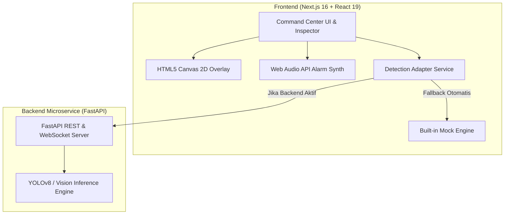

# 🔥 Fire & Smoke Detection System — Command Center Platform

Sistem pemantauan dan deteksi dini anomali api (*fire*) dan asap (*smoke*) berbasis *Computer Vision* dengan antarmuka **Security Operations Command Center** modern, modular, dan berkinerja tinggi.

[](https://nextjs.org/)
[](https://react.dev/)
[](https://tailwindcss.com/)
[](https://fastapi.tiangolo.com/)
[](https://python.org/)
[](https://www.typescriptlang.org/)

---

## 📌 Ringkasan Proyek

Platform ini dirancang untuk mendeteksi bahaya kebakaran dan kepulan asap secara *real-time* melalui umpan kamera CCTV maupun input video/gambar statis. 

Dibangun dengan arsitektur **terpisah (*decoupled*)**:
- **Frontend (Next.js):** Antarmuka responsif *Dark Operations Theme*, rendering *bounding box* akselerasi perangkat keras via HTML5 2D Canvas, serta sirine audio sintetis berbasis Web Audio API lokal. Dilengkapi *intelligent mock engine fallback* sehingga frontend tetap dapat berjalan dan mendemokan fitur tanpa ketergantungan langsung pada backend.
- **Backend (FastAPI Microservice Template):** Menyediakan kontrak REST API & WebSocket yang siap dihubungkan langsung ke model *deep learning* (seperti YOLOv8 / PyTorch).

---

## ✨ Fitur Utama

| Modul | Deskripsi |
| :--- | :--- |
| 🛡️ **Live CCTV Command Center (`/live-scan`)** | Monitoring multi-kamera CCTV (grid 2x2 atau *focus view* 1x1), dukungan live webcam browser dan video simulasi, overlay *bounding box* canvas real-time, status peringatan global (`SAFE`, `WARNING`, `CRITICAL`), sirine audio sintetis (Web Audio API), dan *ticker feed* insiden langsung. |
| 🔬 **Media Inspector (`/inspector`)** | Upload file gambar/video drag-and-drop, slider *confidence threshold* interaktif (10% - 95%), filter toggle kelas (Fire/Smoke), tabel rincian koordinat deteksi per frame, serta tombol ekspor *annotated snapshot*. |
| 📋 **Incident Logs & Audit Trail (`/incidents`)** | Riwayat pencatatan insiden kebakaran, filter pencarian berdasarkan waktu, kamera, dan tingkat keparahan (*severity*), modal pratinjau snapshot insiden, dan ekspor laporan ke format CSV. |
| 🌐 **Interactive Landing Page (`/`)** | Beranda modern dengan metrik statistik deteksi, alur kerja sistem (*system workflow*), dan elemen CTA interaktif. |
| 🔄 **Graceful Fallback & Mock Engine** | Frontend otomatis beralih ke simulasi cerdas jika backend tidak aktif, memudahkan pengujian mandiri kapan pun tanpa setup server AI yang berat. |

---

## 🏗️ Arsitektur Sistem



---

## 📁 Struktur Direktori

```text
fire-smoke-detection/
├── docs/                               # Dokumentasi spesifikasi & perencanaan sistem
│   └── superpowers/
├── frontend/                           # Aplikasi Frontend Next.js (App Router)
│   ├── src/
│   │   ├── app/                        # Routing halaman (/live-scan, /inspector, /incidents)
│   │   ├── components/                 # Komponen modular (command-center, inspector, common, ui)
│   │   ├── hooks/                      # Custom hooks (canvas rendering, audio alarm, camera feeds)
│   │   ├── services/                   # Detection adapter (backend connection & fallback mock)
│   │   └── types/                      # Definisi tipe data TypeScript
│   ├── package.json
│   └── tailwind.config.ts
├── backend/                            # Microservice Vision API (FastAPI)
│   ├── app/
│   │   ├── main.py                     # Entrypoint FastAPI & router endpoint
│   │   └── schemas.py                  # Pydantic schema (selaras dengan frontend types)
│   ├── openapi.yaml                    # Spesifikasi kontrak OpenAPI / Swagger
│   ├── requirements.txt
│   └── README.md                       # Panduan khusus backend & integrasi model
└── README.md                           # Dokumentasi utama proyek
```

---

## 🚀 Panduan Memulai (Quickstart)

### 1. Menjalankan Frontend

Pastikan telah menginstal [Node.js](https://nodejs.org/) (versi 18+).

```bash
# 1. Masuk ke direktori frontend
cd frontend

# 2. Install dependensi
npm install

# 3. Jalankan server development
npm run dev
```

Buka browser di [http://localhost:3000](http://localhost:3000). Secara *default*, frontend langsung berfungsi penuh menggunakan simulasi bawaan (*mock engine*).

---

### 2. Menjalankan Backend (Opsional / Integrasi AI)

Pastikan telah menginstal [Python](https://python.org/) (versi 3.10+).

```bash
# 1. Masuk ke direktori backend
cd backend

# 2. Buat dan aktifkan virtual environment
python3 -m venv venv
source venv/bin/activate       # macOS / Linux
# venv\Scripts\activate        # Windows

# 3. Install dependensi backend
pip install -r requirements.txt

# 4. Jalankan server FastAPI
uvicorn app.main:app --reload --host 0.0.0.0 --port 8000
```

Dokumentasi Swagger API interaktif dapat diakses di: [http://localhost:8000/docs](http://localhost:8000/docs).

---

## ⚙️ Menghubungkan Frontend ke Backend

Buat file `.env.local` di dalam folder `frontend/`:

```env
NEXT_PUBLIC_BACKEND_URL=http://localhost:8000
```

> **Catatan:** Jika backend mati atau URL tidak diset, frontend secara otomatis tetap berjalan mulus menggunakan sistem simulasi *graceful client fallback*.

---

## 📡 Ringkasan Kontrak API

Endpoint backend didefinisikan secara lengkap di `backend/openapi.yaml` dan selaras dengan `frontend/src/types/detection.ts`:

- **`GET /api/v1/health`** — Pemeriksaan status kesehatan mikroservis.
- **`GET /api/v1/cameras`** — Mengambil daftar kamera CCTV aktif beserta metadata dan status deteksi terakhir.
- **`POST /api/v1/detect/image`** — Mengirim file gambar (`multipart/form-data`) untuk dianalisis dan mengembalikan *bounding box* koordinat `[x, y, w, h]`, label (`fire` / `smoke`), dan tingkat *confidence*.
- **`WS /api/v1/ws/cctv/{camera_id}`** — WebSocket stream dua arah untuk umpan *live telemetry* dan deteksi per frame CCTV.

---

## 🤖 Panduan Integrasi Model YOLOv8 / PyTorch

Untuk menghubungkan bobot model terlatih (`best.pt`) ke backend:

1. Install dependensi Ultralytics di folder `backend/`:
   ```bash
   pip install ultralytics opencv-python-headless
   ```
2. Simpan file bobot model pada direktori `backend/weights/best.pt`.
3. Di file `backend/app/main.py`, inisialisasi model dan petakan hasil prediksi ke skema `BoundingBoxSchema`:
   ```python
   from ultralytics import YOLO

   model = YOLO("weights/best.pt")

   @app.post("/api/v1/detect/image")
   async def detect_image(file: UploadFile = File(...)):
       contents = await file.read()
       # Decode gambar dan jalankan inferensi
       # results = model(image_array)
       # Petakan hasil ke BoundingBoxSchema: label, confidence, bbox [x, y, w, h]
       ...
   ```

---

## 🛠️ Tech Stack

- **Frontend:** Next.js 16 (App Router), React 19, TypeScript, Tailwind CSS v4, Lucide React, HTML5 Canvas 2D, Web Audio API.
- **Backend:** FastAPI, Pydantic v2, Uvicorn, WebSockets, OpenAPI Specification.
- **Computer Vision Ready:** Ultralytics YOLOv8 / PyTorch / OpenCV.