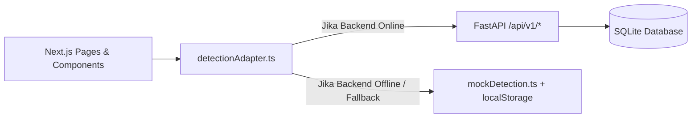

# 🔥 Fire & Smoke Detection — Frontend Command Center (Next.js)

Aplikasi frontend antarmuka **AI Vision Command Center** berbasis **Next.js 16 (App Router)**, **React 19**, dan **Tailwind CSS v4** untuk deteksi bahaya api (*fire*) dan asap (*smoke*) secara *real-time*.

Dirancang dengan prinsip **Decoupled Architecture** dan **Resilient Graceful Fallback**, sehingga frontend dapat berjalan mandiri 100% menggunakan engine simulasi browser lokal maupun terhubung secara penuh ke mikroservis backend FastAPI.

---

## ✨ Halaman & Modul Utama

### 1. `/` — Interactive Landing Page
- **Hero Section & Live Scanner Demo**: Visualisasi interaktif pemindaian api/asap langsung di beranda dengan tombol CTA proporsional (`w-full sm:w-[245px] h-[54px]`).
- **Bento Grid Architecture**: Menampilkan kapabilitas *Live Scan*, *Media Lab*, dan *Incident Logs* dengan tautan aksi langsung.
- **Dual-Detection Stage**: Penjelasan alur verifikasi ganda (deteksi optik api dan analisis volumetrik kepulan asap).
- **Benchmark & Telemetry Metrics**: Tabel komparasi akurasi mAP50, latensi inferensi, dan konsumsi memori.

### 2. `/live-scan` — Real-Time Live Scan & Webcam Scanner
- **Webcam Flame Scanner (`useWebcamScanner`)**: Mendeteksi titik api langsung dari webcam perangkat pengguna secara *real-time*, dengan logika pemilihan webcam fisik otomatis (melewati OBS / kamera virtual).
- **Simulasi Umpan CCTV**: Mode pemantauan area industri (Gudang Bahan Kimia, Tangki Bahan Bakar, Area Bebas Api).
- **HUD Bounding Box Overlay**: Rendering kotak deteksi dinamis dengan koordinat ternormalisasi di atas video stream.
- **Telemetry Sidebar & Synthetic Siren**: Menampilkan persentase akurasi, estimasi suhu, sirine audio sintetis berbasis Web Audio API (`useAlarmSound`), serta pemicu pencatatan insiden otomatis.

### 3. `/inspector` — Media Inspector Lab
- **Drag & Drop Media Uploader**: Mendukung analisis file gambar (JPG, PNG, WebP) dan video (MP4, WebM) hingga 50MB.
- **One-Click Presets**: Sampel cepat gambar uji api (`preset-fire`), asap (`preset-smoke`), dan deteksi ganda (`preset-dual`).
- **Interactive Threshold & Class Controls**: Slider sensitivitas deteksi (10%–95%) serta filter per kelas (*Fire* / *Smoke*).
- **Annotated Snapshot Export**: Kemampuan mengekspor gambar hasil deteksi lengkap dengan *bounding box* dan label akurasi.

### 4. `/incidents` — Incident Logs & Audit Hub
- **Auto-Recorded Incidents**: Riwayat insiden yang otomatis tercatat saat api terdeteksi di Live Scan maupun Media Lab.
- **Stat Cards & Filter Multi-Kriteria**: Statistik status aktif, dalam investigasi, dan terselesaikan, dilengkapi pencarian kata kunci dan filter tingkat keparahan.
- **Snapshot Inspection Modal**: Modal resolusi tinggi untuk meninjau detail tangkapan layar, koordinat deteksi, serta catatan operator.
- **Ekspor Laporan CSV**: Mengunduh seluruh riwayat insiden dalam format file spreadsheet CSV.

---

## 🔐 Sistem Autentikasi & Manajemen Pengguna (Langkah 1)

Frontend telah dilengkapi sistem state autentikasi reaktif (`AuthContext.tsx`) dan modal interaktif (**Google Sign-In**) dengan simulasi peran (*role simulation*):

### Profil Pengguna Demo:
| Peran | Nama | Email | Akses & Wewenang |
| :--- | :--- | :--- | :--- |
| **Operator** | Budi Santoso | `budi.santoso@safety.aegisflame.id` | Pemantauan live webcam, respon awal alarm, pembaruan status investigasi. |
| **Supervisor K3** | Rian Pratama, S.T. | `rian.pratama@hse.aegisflame.id` | Resolusi insiden, audit keselamatan kerja, otorisasi laporan insiden resmi. |

### Fitur Autentikasi Frontend:
- **Global Context Provider (`useAuth()`)**: Membungkus seluruh aplikasi melalui `frontend/src/app/layout.tsx`.
- **Persistensi Sesi Lokal**: Status login pengguna tersimpan aman di `localStorage` dengan key `aegisflame_auth_user`.
- **HeaderNav Dinamis**:
  - *Belum Login*: Tombol "Masuk" dengan logo Google resmi.
  - *Sudah Login*: Menampilkan avatar pengguna, nama, status shift aktif, badge peran, serta dropdown menu logout.

---

## 🔌 Komunikasi Data & Adaptor Backend (`detectionAdapter.ts`)

Seluruh komunikasi antara antarmuka Next.js dan backend FastAPI dijembatani oleh `frontend/src/services/detectionAdapter.ts`:



### Operasi Data yang Didukung:
1. **Mengambil Riwayat Insiden (`getIncidentRecords`)**: Memanggil `GET /api/v1/incidents`. Jika gagal, menggabungkan data lokal `localStorage` dengan data awal (*seed*).
2. **Mencatat Insiden Baru (`recordIncident`)**: Menyimpan ke `localStorage` browser dan mengirimkan payload JSON ke `POST /api/v1/incidents`.
3. **Memperbarui Status Insiden (`updateIncidentStatus`)**: Mengirimkan `PATCH /api/v1/incidents/{id}` dengan status baru (`active`, `investigating`, `resolved`).
4. **Menghapus Insiden (`deleteIncident`)**: Mengirimkan `DELETE /api/v1/incidents/{id}`.
5. **Inferensi Gambar/Video (`detectImage`)**: Mengirimkan file via `multipart/form-data` ke `POST /api/v1/detect/image` atau `POST /api/v1/detect/video`.
6. **Live Camera WebSocket (`getStreamWebSocketUrl`)**: Membuka koneksi `ws://localhost:8000/api/v1/ws/cctv/{cameraId}` untuk streaming frame live.

---

## 🚀 Panduan Menjalankan Frontend

### Prasyarat
- [Node.js](https://nodejs.org/) v18.0.0 atau yang lebih baru.
- npm v9+

### Langkah Instalasi
```bash
# 1. Masuk ke folder frontend
cd frontend

# 2. Pasang dependensi
npm install

# 3. Jalankan server development
npm run dev
```

Buka peramban di [http://localhost:3000](http://localhost:3000).

---

## ⚙️ Menghubungkan ke Backend Lokal (Untuk Rekan Backend)

Untuk menghubungkan antarmuka ini dengan server FastAPI yang berjalan di komputer lokal:

1. Buat file `.env.local` di dalam folder `frontend/`:
   ```env
   NEXT_PUBLIC_BACKEND_URL=http://localhost:8000
   ```
2. Pastikan server FastAPI backend Anda telah berjalan di port 8000:
   ```bash
   cd ../backend
   uvicorn app.main:app --reload --port 8000
   ```
3. Restart server Next.js jika sedang berjalan (`Ctrl + C` lalu `npm run dev`).
4. Buka halaman `/incidents` atau `/live-scan` dan periksa tab *Network* di inspect element browser untuk melihat request ke `http://localhost:8000/api/v1/*`.
